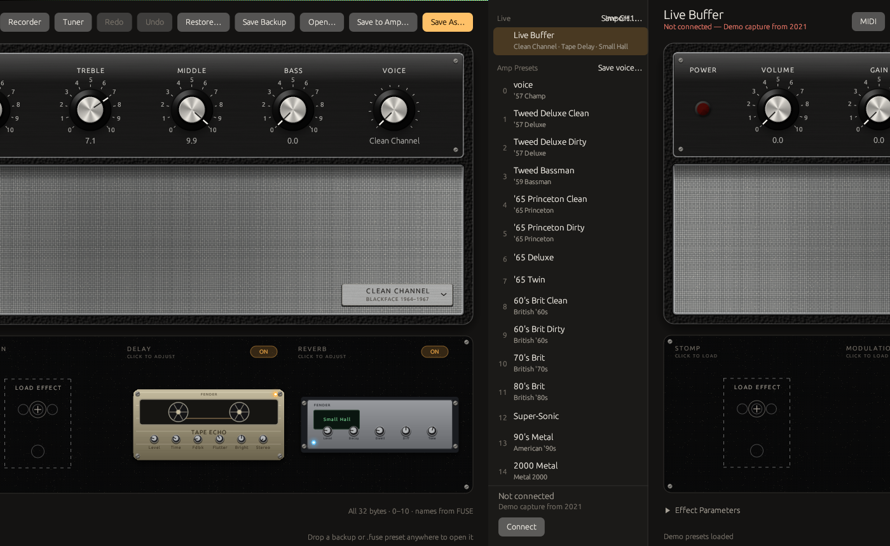
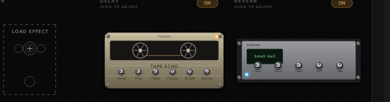

# scx2

An open-source preset editor and librarian for the **Fender Super Champ X2**.

Fender FUSE is gone, and the amp has no software of its own. scx2 talks to the
amplifier directly over USB: it reads the presets stored in the amp, shows them
on a screen that mirrors the front panel, and writes edits back. No Silverlight,
no 2013 runtime.



## What it does

- **Browse and back up** every preset stored in the amp, to a lossless JSON file.
- **Edit the front panel** — Volume, Gain, Treble, Middle, Bass and Voice — and
  the four effect slots: stomp, modulation, delay and reverb.
- **Pick amps and cabinets** from the fourteen Super Champ X2 voices and FUSE's
  cabinet list.
- **Save to a slot**, rename stored presets, and restore a whole backup.
- **Import and export** Fender FUSE `.fuse` presets.
- **Tune and record** using the amp's USB audio output.
- **Control effects with a MIDI foot controller.**
- Works **without the amp**, using a bundled capture recorded from FUSE in 2021.

Reading, editing, saving, renaming and restoring are verified on a real Super
Champ X2 (firmware `May 30 2013`).



## Download

Get the latest build from the
[**releases page**](https://github.com/ArtemKunik/scx2/releases/latest):

| Platform | File |
| --- | --- |
| Linux x86-64 | `scx2-<version>-x86_64-unknown-linux-gnu.tar.gz` |
| Windows x86-64 | `scx2-<version>-x86_64-pc-windows-msvc.zip` |

Each release also carries `SHA256SUMS` covering both archives.

### Linux

```console
tar xzf scx2-*-x86_64-unknown-linux-gnu.tar.gz
cd scx2-*/
sudo ./install.sh     # once: lets your user open the amp without root
./scx2
```

A desktop session (X11 or Wayland) and ALSA are all it needs. The build targets
Ubuntu 22.04, so it runs on Ubuntu 22.04+, Debian 12 and anything newer.

### Windows

Unzip and run `scx2.exe`. Nothing to install and no runtime to download. The
executable is not code-signed, so SmartScreen may ask once: **More info → Run
anyway**.

## Getting started

1. Connect the amp with a USB data cable and switch it on.
2. Start `scx2`. The window mirrors the amp: knobs follow the amp as you turn
   them, and your edits are heard immediately, with no write button.
3. Try a different voice, load an effect, save the result with **Save to Amp…**,
   which writes the live sound into a bank/slot and reads it back.
4. **Save Backup** stores the whole amp as JSON; **Restore…** writes it back.

Stored presets are edited in place only in the live buffer, and a `●` in the
title means the live sound has unsaved changes. Loading a stored preset is done
with the amp's own front-panel knob — the amp has no command to recall a slot
from the computer, so the editor simply follows what the amp is playing.

Without an amp connected, the editor opens the demo capture, so every screen can
be explored and edits stay in the file.

## Building from source

Rust 1.75 or newer.

```console
cargo build --release
cargo test
target/release/scx2
```

On Linux the editor also needs ALSA's development headers: `sudo apt install
libasound2-dev`, or `alsa-lib-devel` on Fedora and `alsa-lib` on Arch.

## Documentation

- [docs/cli.md](docs/cli.md) — command line reference
- [docs/editor.md](docs/editor.md) — the editor in detail
- [docs/protocol.md](docs/protocol.md) — the amp's USB protocol
- [docs/parameters.md](docs/parameters.md) — parameter map
- [docs/fuse.md](docs/fuse.md) — Fender FUSE `.fuse` files
- [docs/recording.md](docs/recording.md) — audio capture
- [docs/linux.md](docs/linux.md) — Linux notes and delivery spec
- [docs/architecture.md](docs/architecture.md) — how the code is laid out
- [docs/test-plan.md](docs/test-plan.md) — hardware test plan

## Credits

- The protocol capture comes from `rmduddy`, published on
  [snhirsch/mustang-midi-bridge issue #6](https://github.com/snhirsch/mustang-midi-bridge/issues/6).
- Model id tables and the Mustang framing reference:
  [snhirsch/mustang-midi-bridge](https://github.com/snhirsch/mustang-midi-bridge) (GPL-3.0).
- Effect parameter names, per-model defaults and the `.fuse` XML shape:
  [jtangelder/refuse](https://github.com/jtangelder/refuse).
- [midir](https://github.com/Boddlnagg/midir) (MIT) provides MIDI input for the
  foot-controller bridge.
- [OpenFUSE](https://github.com/dbarbashov/openfuse) (MIT) pointed to the meaning
  of the `0x05` and `0x1d` reports and the write acknowledgement.

## License

MIT. Unofficial project, not affiliated with Fender. Use it on hardware you own.
